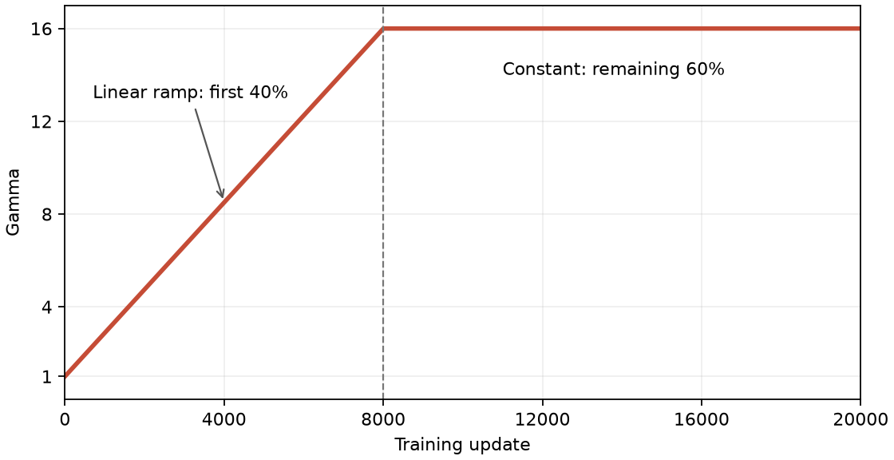

# Larger network and longer CPU training

The initial 0.41M-parameter models had loss near field-aware random guessing.
This follow-up increases capacity and training exposure while retaining the
arithmetic task, CPU execution, and disabled exponentiation toggle.

**Stopped at the user's request.** The latest durable curriculum checkpoint is
at update 14,000 of 20,000. The hard and mixture arms never started, so this is
an incomplete diagnostic, not a matched comparison. A larger GPU experiment is
being prepared after connecting W&B; no replacement training run has started.

## Recipe

| Setting | Initial CPU runs | Larger follow-up |
| --- | ---: | ---: |
| Layers | 2 | 4 |
| Embedding width | 128 | 256 |
| Attention heads | 4 | 4 |
| Total parameters | 406,656 | 3,173,632 |
| Updates per arm | 1,000 | 20,000 |
| Answers per update | 32 | 32 |
| Total answers per arm | 32,000 | 640,000 |
| Peak learning rate | 0.0006 | 0.0003 |
| Warmup updates | 20 | 200 |
| Context length | 72 | 72 |
| Gamma low / high | 1 / 16 | 1 / 16 |
| Curriculum ramp fraction | 40% | 40% |
| Exponentiation | Disabled | Disabled |
| Division | Enabled | Enabled |

Use [configs/cpu_large.json](configs/cpu_large.json) with `--include-division`
to reproduce this historical recipe (current presets default division off). The curriculum reaches
gamma 16 on update 8,000 and remains there through update 20,000. The hard arm
uses gamma 16 throughout. The shuffled mixture uses exactly the same scheduled
gamma values as curriculum in randomized update order. All three planned arms use seed 0
and the same initialization, model/optimizer recipe, answer budget, and evaluation
streams. This first larger comparison uses one seed and cannot establish
robustness across initializations.

The curve is a fixed linear ramp followed by a plateau. For zero-based update
index `t`, it is `gamma(t) = 1 + 15 * min(t / 7999, 1)`. Loss and accuracy do not
change the schedule.



The main monitored evaluation has 128 items per field (1,024 total), every 1,000
updates. The final independent sample has 1,024 per field (8,192 total) at each
gamma in `{0, 1, 4, 8, 16}`. Final gamma-16 loss is the primary endpoint.
The uniform-within-field reference is **2.01095056 nats / 18.19% accuracy**.

## Execution and diagnostics

The initial 100-update CPU benchmark took 6.19 training seconds, suggesting
roughly 20–25 minutes per arm before evaluation/checkpoint overhead. That
checkpoint was resumed for the curriculum arm, preserving the 20,000-update
schedule horizon and RNG state. The extra evaluation at step 100 does not consume
training randomness. The sweep was configured to run sequentially on four CPU threads.

A separate diagnostic at update 100, with 32 items per field, measured:

| Gamma | Answer loss | Accuracy |
| --- | ---: | ---: |
| 0 (literal copying) | 0.3886 | 99.22% |
| 1 | 1.5677 | 54.30% |
| 16 | 2.3723 | 15.23% |

This shows strong early literal copying under the larger model and longer easy
phase. At update 13,000, a diagnostic on the same sample size measured gamma-0
loss 1.8218 and 25.0% accuracy, indicating substantial forgetting of literal
copying. Gamma-16 loss was 1.9529 with 26.17% accuracy on that small sample.

At the last durable checkpoint (update 14,000), the larger monitored gamma-16
sample measured loss **1.9693**, accuracy **24.7%**. Its field-frequency baseline
was loss **2.0009**, accuracy **25.10%**. These observations do not establish
adequate arithmetic learning or identify whether capacity, training budget,
curriculum timing, or another limitation is responsible.

Artifacts are under `out/finite-field/cpu-large/`; the saved checkpoint is
`curriculum-seed0/checkpoint.pt`. Historical metrics can be uploaded to W&B
without training, as described in [TRACKING.md](TRACKING.md).
To deliberately resume the old sweep later:

```sh
.venv/bin/python -m experiments.finite_field.sweep \
  --config experiments/finite_field/configs/cpu_large.json \
  --conditions curriculum hard mixture --seeds 0 --include-division \
  --out-dir out/finite-field/cpu-large --resume
```
