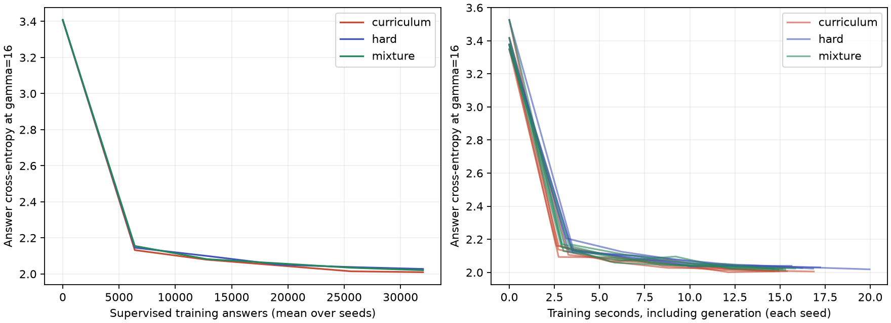
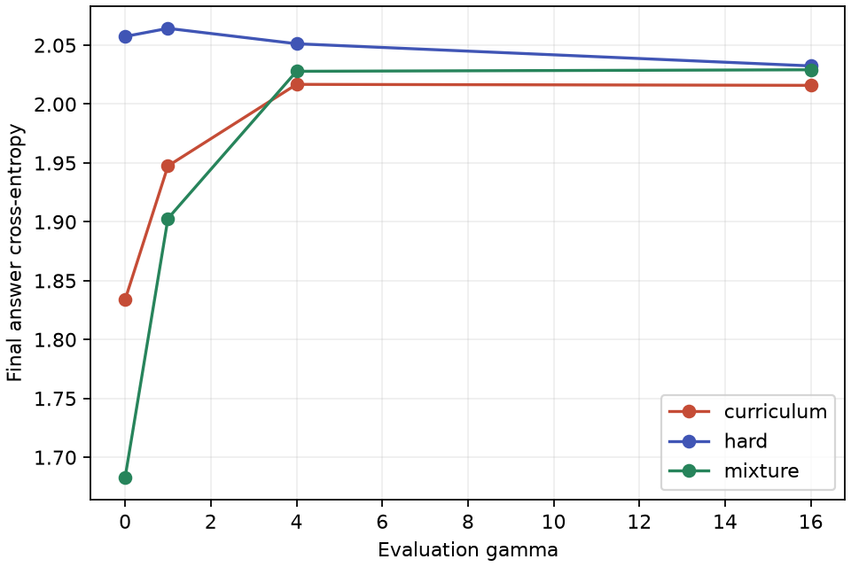

# Initial CPU results

These historical runs use `+ - * /` only (`include_power=false`, division enabled).
Current presets disable division; use `--include-division` when reproducing
these results. The later division-disabled GPU comparison is documented in
[GPU_RESULTS.md](GPU_RESULTS.md). The field-order token for
19 is `j`. Loss is answer cross-entropy in nats, evaluated at fixed gamma 16.
All runs use CPU float32 and four PyTorch threads. No cloud resources were used.

## Correctness and pipeline checks

The initial eight automated tests pass, covering every binary operation on all
eight fields, generated-expression evaluation, field/size balance, generator
replay, character format, target alignment and causal isolation, schedules,
independent balanced evaluation, and bitwise CPU checkpoint resume with dropout.
The optional exponentiation semantics are tested even though runs disable it.

The fixed-sample overfitting check reached **100% accuracy** on 16 items after
250 updates: loss fell from **3.367622** to **0.002447**. This verifies the training
path; it is not a generalization measurement.

## Short pilot

Recipe: [pilot.json](configs/pilot.json), seed 0, 300 updates × 16 answers,
2 layers, embedding width 64, context 72, gamma ramp 1→16 over the first 40%
of updates. Each final evaluation uses 128 examples per field (1,024 total),
separate from the monitored evaluation stream.

| Condition | Final loss | Accuracy |
| --- | ---: | ---: |
| Hard from start | 2.239371 | 24.80% |
| Curriculum | 2.237192 | 23.73% |
| Shuffled mixture | 2.240969 | 23.05% |
| Field-frequency baseline | 2.010991 | 24.32% |
| Uniform within the known field | 2.010951 | 18.19% |

The curriculum-minus-hard loss difference is **−0.002179** for this one seed.
That is insufficient evidence for a curriculum benefit. All models have worse
loss than the separately calibrated field-frequency baseline, so this pilot
does not establish learned arithmetic. It establishes an end-to-end working
comparison and motivates measuring the larger preset without adjusting it to
favor any arm.

The full resolved recipe and numerical results are preserved in
[results/pilot_summary.json](results/pilot_summary.json). Raw checkpoints,
JSONL metrics, final evaluations, and plots are under `out/finite-field/pilot/`.

## Five-seed CPU comparison

Recipe: [cpu.json](configs/cpu.json), unchanged after the pilot, seeds 0–4,
1,000 updates × 32 answers per run (32,000 supervised answers), 2 layers,
embedding width 128, context 72. All 15 runs completed. The initial target loss
matches exactly within each seed's three arms, confirming paired initialization
and a common evaluation sample. Each final evaluation has 256 examples per field
(2,048 total), shared across arms and seeds and separate from training/monitoring.

| Condition | Mean final loss | Mean accuracy | Mean training seconds |
| --- | ---: | ---: | ---: |
| Hard from start | 2.032438 | 24.62% | 17.18 |
| Curriculum | **2.015936** | 24.57% | 15.40 |
| Shuffled mixture | 2.029148 | 24.65% | 15.19 |
| Field-frequency baseline | 2.008393 | 24.02% | — |
| Uniform within the known field | 2.010951 | 18.19% | — |

Training seconds include generation/batching/updates and exclude evaluation,
initialization, and checkpointing. Fixed padded shapes match dense model work,
but simpler expressions need less generation work. These sequential local
timings are descriptive, not a controlled hardware benchmark.

| Seed | Hard loss | Curriculum loss | Mixture loss | Curriculum − hard |
| --- | ---: | ---: | ---: | ---: |
| 0 | 2.025966 | 2.015316 | 2.026963 | −0.010650 |
| 1 | 2.030869 | 2.017185 | 2.032442 | −0.013684 |
| 2 | 2.034307 | 2.016312 | 2.024045 | −0.017995 |
| 3 | 2.037294 | 2.014536 | 2.031881 | −0.022758 |
| 4 | 2.033756 | 2.016329 | 2.030406 | −0.017427 |

Curriculum has lower final loss than both controls in all five seeds:

- Curriculum − hard: **−0.016503 nats**, 95% seed-bootstrap interval
  **[−0.019900, −0.013071]**.
- Curriculum − mixture: **−0.013212 nats**, interval
  **[−0.015856, −0.010081]**.
- Mixture − hard: −0.003291 nats, interval [−0.007040, 0.000358].

This supports a modest curriculum loss advantage **for this model, budget, and
sampling distribution**. It does not establish reliable arithmetic evaluation:
accuracy is essentially unchanged, and the independent field-frequency baseline
still has lower loss than every arm. Five-seed bootstrap intervals are
exploratory and condition on the shared finite evaluation sample. Longer
training and stronger arithmetic diagnostics are appropriate follow-up work;
the present experiment has not been retuned after seeing these outcomes.

The curves use the monitored evaluation stream; the tables above use the fresh
final stream, so their endpoint losses need not match exactly.

Resolved configuration, per-seed results, and intervals are preserved in
[results/cpu_summary.json](results/cpu_summary.json). Raw artifacts are under
`out/finite-field/cpu/`, including field/size/depth breakdowns in each run's
`final.json` and PDF plots in `comparison/`.

Environment: Python 3.12.14, PyTorch 2.14.1, macOS/ARM CPU, four threads.
[requirements-cpu-lock.txt](requirements-cpu-lock.txt) records installed package
versions. Each main run's `environment.json` records source SHA-256 hashes and
git state. Results were generated from the working tree on the experiment branch.

## Larger and longer training

The initial models do not beat the field-aware uniform predictor on loss.
Its analytic loss is `mean(log(p)) = 2.0109505605` nats, and its expected accuracy
is `mean(1/p) = 18.1934719%`, averaging equally over the eight fields. This is a
more informative reference than guessing uniformly over the entire vocabulary.

A follow-up with 3.17M parameters and 20,000 planned CPU updates per arm was
stopped at the user's request during the curriculum arm, with a checkpoint at
14,000 updates. The other two arms never started. See [LARGER_CPU.md](LARGER_CPU.md)
for diagnostics; this is not a completed matched comparison.

Historical metrics are also available in
[W&B](https://wandb.ai/kanhar/finite-field-curriculum), grouped as `cpu-pilot`,
`cpu-baseline`, and `cpu-large-stopped`. See [TRACKING.md](TRACKING.md) for the
logging and import protocol.
