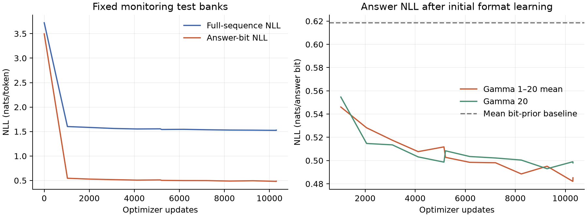

# Ten-minute shuffled learning diagnostic

Requested on 2026-10-25 in Google Cloud project `personal-383909`.
Completed all 10,304 updates; both VMs were confirmed stopped afterward.
This is a short learning check, not a curriculum-versus-control comparison.
Every training example is freshly sampled and numerically checked. No survey
examples or repeated training pool are used by the optimizer.

## Frozen configuration

| Setting | Value |
| --- | --- |
| Condition / seed | Shuffled / 0 |
| Model | 64 layers, width 512, 8 heads, FF width 2048 |
| Parameters | 201,480,192 |
| GPU / precision | One H100 80 GB / BF16 autocast |
| Context | 128 tokens, packed complete records, leading newline |
| Batch | 16 expressions per update, before packing |
| Updates | 10,304 |
| Training examples | 164,864 freshly generated examples |
| Gamma | 1 through 20, using the shuffled curriculum batch plan |
| Underlying curriculum | Linear ramp over 5,212 updates, then gamma 20 |
| LR | Linear warmup for 103 updates to 0.0003, then constant |
| Objective | Full-sequence next-token NLL, masking padding only |
| Budget | Approximately 600 seconds of optimizer computation; evaluation adds wall time |

The shuffled condition permutes all batches of the frozen curriculum plan;
within-batch examples and order are unchanged. Only shuffled is run here.
There are separate procedural monitoring train/test banks of 32 examples per
gamma, final banks of 64 per gamma, and baseline-calibration banks of 128 per
gamma. Total accepted labels, including these banks, is 171,264.

Teacher-forced evaluation runs every 1,030 updates and at required boundaries.
Free answer generation runs every 5,150 updates and at boundaries, with two
examples per monitoring cell and four per final cell. These generation counts
are suitable for a smoke check, not a precise accuracy estimate. W&B reports
answer, full-sequence, non-answer, sign, exponent, and mantissa NLL separately
for each gamma and split, plus numerical generation metrics and baselines.

## H100 batch calibration

Each candidate was checked on gamma 1, 10, and 20 and an analytic maximum-length
86-token record. Memory below is the maximum reservation across those probes.
Benchmark sample reuse is confined to calibration; all benchmark weights are
discarded before the fresh training run.

| Expressions/update | Context | Examples/s | Peak reserved VRAM | Result |
| ---: | ---: | ---: | ---: | --- |
| 64 | 128 | 1,136 | 15.7% | Pass |
| 128 | 128 | 2,205 | 26.5% | Pass |
| 256 | 128 | 3,187 | 49.5% | Pass |
| 512 | 128 | — | 95.5% | Insufficient memory headroom |
| 64 | 256 | 1,154 | 15.7% | Pass |
| 128 | 256 | 2,199 | 26.5% | Pass |
| 256 | 256 | 3,361 | 49.5% | Fastest passing candidate |
| 512 | 256 | — | 95.5% | Insufficient memory headroom |

Peak-throughput training would need about 1.83 million fresh integral labels for
this budget. The short diagnostic instead uses batch 16/context 128 to reduce
CPU preparation. That setting measured roughly 294–302 examples/s and reserved
at most 6.4% of VRAM. Batch 32 also passed, at roughly 578–593 examples/s and
9.3% peak reservation. Batch 16 is intentionally a preparation-time tradeoff,
not the GPU throughput optimum.

## Execution and persistence

The GPU VM is `integrals-h100-smoke` in `us-central1-a`, with a retained 200 GB
balanced persistent boot disk. The temporary CPU preparation VM is
`integrals-data-smoke`, using `n2-highcpu-64` and 48 label workers. Google granted
the required GPU/CPU quota increases; the attempted 96-vCPU size had no capacity
in this zone. The H100 is stopped during fresh-label generation.

The exporter uses `--conditions shuffled`, avoiding unused hard-only samples.
An immutable corpus manifest and per-file checksums are verified before training.
The local controller transfers the corpus, starts the H100, relays the existing
JSONL metrics to W&B using local credentials, downloads and verifies the final
checkpoint, and stops both VMs. Credentials are not copied to either VM.
The GPU has a 30-minute automatic-stop safeguard for setup, training, evaluation,
and result transfer; the training service has a 25-minute runtime limit.

Local operational files are in `out/integrals-h100-shuffled10m-20261025/`:
`controller-state.json`, `controller.log`, `calibration/`, the frozen
`small-batch-config.json`, numerical corpus, and downloaded results. The remote
checkpoint path is `/home/kanhar/nanoGPT/out/shuffled10m/shuffled-seed0/checkpoint.pt`.
The verified local checkpoint is
`out/integrals-h100-shuffled10m-20261025/results/out/shuffled10m/shuffled-seed0/checkpoint.pt`
(2,418,275,397 bytes). Its SHA-256 is
`352ccb3fcd332459db5ec5f3d4aacdbda9d506e9cbc1f340c679507b5c0002c3`.
Both VMs are stopped; their 200 GB and 100 GB persistent disks are retained.

## Observed results

[W&B run](https://wandb.ai/kanhar/numerical-integrals-curriculum/runs/ylp0hi7j),
[machine-readable results](results/h100_shuffled10m.json), and
[measured calibration](results/h100_calibration.json).

On the fixed monitoring test banks:

| Metric | Initial | Final |
| --- | ---: | ---: |
| Answer NLL, gamma 1–20 mean | 3.4958 | 0.4852 |
| Full-sequence NLL, token-weighted | 3.7227 | 1.5287 |
| Gamma-20 answer NLL | 3.4714 | 0.4980 |

The separate fresh final test bank gives mean answer NLL **0.4853**, versus
**0.6212** for the independent per-position bit-prior baseline. Gamma-20 answer
NLL is **0.4880**, versus its **0.6231** baseline. These losses use 64 examples per
gamma, 1,280 final test examples in total.

Free greedy decoding on four fresh test prompts per gamma (80 total) produced:

| Metric | Count |
| --- | ---: |
| Valid canonical answer formats | 80 / 80 |
| Exact quantized answers | 1 / 80 |
| Answers within the configured numerical tolerance | 1 / 80 |
| Always-zero exact answers on those same 80 prompts | 4 / 80 |

Tolerance is `1e-6 + 0.01*abs(reference)`. The paired zero baseline above uses the
same decoding subset; W&B's existing per-cell zero baseline uses the full bank.
Eighty prompts give only a coarse accuracy estimate. The loss reduction confirms
that optimization and output-format learning work. It does **not** demonstrate
reliable numerical integration, and this single shuffled run cannot establish
a curriculum benefit. The independent-bit baseline also omits correlations
between answer bits, so beating it is not by itself evidence of integration.

Measured times were **523.76 s training**, **67.79 s evaluation**, and **9.77 s
loading**: 601.32 seconds of tracked work. Training/evaluation/loading were about
87.1%/11.3%/1.6% of that total. Model setup, checkpoint serialization, and transfers
add wall time and are not included in those counters. Training supervised
7,376,095 tokens. LR remained 0.0003 after its 103-update warmup.

The corpus contains 171,264 accepted labels in 651 shards. Numerical checks
rejected 14,819 candidates (about 8.0%): 6,431 uncertain-discontinuity cases,
4,609 timeouts, 3,776 other value errors, and 3 ineligible cases. Preparation
resumed from verified committed shards after a service restart. No finite
training pool was replayed. The manifest SHA-256 is
`af29d80e964a587d577c026f11ef4dd758a26757d5e78892dadc12a721c8c387`.

Validation included 49 local tests, successful full CUDA training and final
evaluation, manifest/checkpoint checksum verification, and checking all 60
logged training-batch hashes, identities, gammas, and learning rates against the
frozen fresh corpus and shuffled plan. W&B was flushed before VM shutdown.
