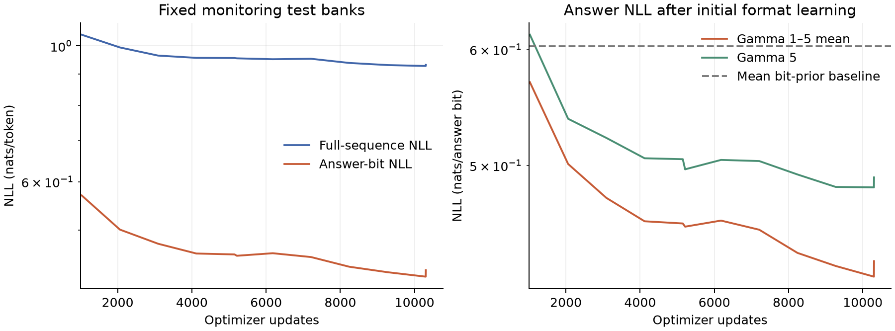

# Shuffled diagnostic restricted to gamma 1–5

Requested on 2026-10-25 after the [gamma 1–20 diagnostic](GPU_DIAGNOSTIC.md).
The purpose is to check whether the easier mixture learns useful numerical
answers within a short run. Training and evaluation both stop at gamma 5.

The network and optimizer are unchanged: 64 layers, width 512, 8 attention
heads, FF width 2048, 201,480,192 parameters, BF16 autocast, context 128,
16 expressions per update, seed 0, and 10,304 updates. LR warms up for 103
updates to 0.0003 and then stays constant. The objective remains full-sequence
next-token NLL with padding masked.

The underlying curriculum ramps linearly from gamma 1 to 5 over 5,212 updates,
then stays at 5. This run shuffles those batch indices, including the plateau.
It is not a uniform mixture over five integer gamma values. No gamma above 5
is selected, although AST operator count is still a Poisson draw controlled by
gamma, capped at 32. The generator's operations, bounds, numerical checks, and
answer encoding are unchanged.

Training uses 164,864 newly generated procedural samples, with no replayed
finite pool. The total evaluation sample budget is concentrated on five gammas:

| Bank | Samples per gamma per split | Total across both splits |
| --- | ---: | ---: |
| Fixed monitoring loss banks | 128 | 1,280 |
| Fresh final loss banks | 256 | 2,560 |
| Monitoring free decoding subset | 8 | 80 per decoding evaluation |
| Final free decoding subset | 16 | 160 |

Independent baseline banks have 512 samples per gamma (2,560 total). The entire
accepted corpus therefore has 171,264 labels, as in the first diagnostic.
Loss is evaluated every 1,030 updates and at required boundaries. Free decoding
runs at initialization, every 5,150 updates, at the underlying ramp boundary,
and at the endpoint, followed by a fresh final evaluation. Free-decoding counts
are subsets of the loss banks, not extra labels.

Execution uses the existing `integrals-data-smoke` CPU VM and
`integrals-h100-smoke` H100 VM in `personal-383909`, zone `us-central1-a`.
The dedicated remote directory is `/home/kanhar/nanoGPT-gamma5`, preserving
the first run. The H100 stays stopped during CPU labeling. A local controller
relays metrics to W&B without transferring credentials, downloads/verifies the
checkpoint, and stops both VMs after completion. The retained boot disks hold
the remote data and checkpoints.

Local operational files are in
`out/integrals-h100-shuffled-gamma5-10m-20261025/`. The
[archived gamma dashboard](https://wandb.ai/kanhar/numerical-integrals-curriculum?nw=c0oyk84007t)
contains only the five gamma sections and is filtered to this run. The earlier
run is preserved in a [gamma 1–20 archive](https://wandb.ai/kanhar/numerical-integrals-curriculum?nw=bfp0x6fybm1).
Both dashboards and the personal workspace start all plots at update 1,000 and
use logarithmic Y axes. Full histories, including zero values that cannot be
shown on a log axis, remain available in the logged data.

## Results

[W&B run](https://wandb.ai/kanhar/numerical-integrals-curriculum/runs/cx0innx1):
`shuffled-gamma1-5-fresh-10min-seed0`. All 10,304 updates completed. Tracked time
was 565.50 s training, 38.80 s evaluation, and 7.73 s loading: 612.03 s total,
excluding setup, checkpoint saves, and transfers. Training accounted for 92.4%
of that total and evaluation 6.3%.

| Test metric | Initial fixed bank | Final fixed bank | Fresh final bank |
| --- | ---: | ---: | ---: |
| Answer NLL, nats/bit | 3.47330 | 0.43021 | 0.42681 |
| Full-sequence NLL, nats/token | 3.66240 | 0.93119 | 0.92927 |
| Independent answer-bit prior NLL | 0.60303 | 0.60303 | 0.60099 |

Fresh final answer NLL by gamma is 0.34581, 0.40473, 0.43452, 0.46314,
and 0.48584 for gamma 1 through 5, respectively. Every final loss cell uses
256 independent examples; these are not the fixed monitoring examples.

Greedy decoding on 80 fresh test prompts produced 80 valid formats, but only
2 exact answers (2.5%) and 2 within numerical tolerance. Always predicting zero
gets 10 of those same 80 prompts exactly right (12.5%). Thus the easier mixture
improves likelihood and learns the answer format, but useful numerical accuracy
has not emerged in this short run. The bit-prior baseline ignores correlations
between answer bits, so beating it does not establish integration competence.
This single shuffled diagnostic does not measure a curriculum benefit.

The [result JSON](results/h100_shuffled_gamma5_10m.json) contains the full grids,
configuration, environment, generation statistics, and paired zero baseline.
All 60 logged training batches were checked against their fresh corpus hashes,
batch seeds, shuffled indices, gamma, and constant-after-warmup learning rates.
The full corpus was verified: 171,264 accepted samples, 2,529 rejected generation
attempts, and 646 shards. Every training and evaluation gamma lies in [1, 5].
The data manifest SHA-256 is
`94f95e20b6cb4ada7ec1be15cbbeb438d83022c6b7f660655bbc9102d3b6a1f1`.

The final checkpoint is saved locally at
`out/integrals-h100-shuffled-gamma5-10m-20261025/results/out/shuffled10m/shuffled-seed0/checkpoint.pt`
and on the retained GPU boot disk at
`/home/kanhar/nanoGPT-gamma5/out/shuffled10m/shuffled-seed0/checkpoint.pt`.
The 2,418,275,333-byte local copy matches the remote SHA-256:
`230e516715103d90d74289919af8be85495f76f7fbe5bc5bf1e5c72cb135e74f`.
W&B reports the run finished, and both experiment VMs were independently
confirmed `TERMINATED` after the download. Their boot disks are retained.
