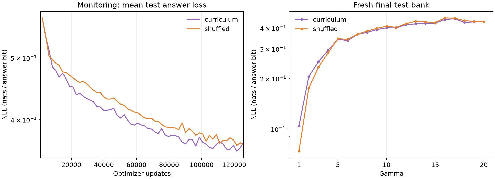

# Integral curriculum versus exact shuffled replay

Completed on October 25–26, 2026, in Google Cloud project `personal-383909`.
Both conditions finished **125,796 updates** on one H100, sequentially, using
identical training expressions and model initialization. Curriculum reduced mean
monitoring test loss faster through much of training, but the final answer losses
were nearly equal. This single-seed experiment shows no clear final curriculum
advantage; it does not establish equivalent behavior across seeds or longer runs.

## Results

| Fresh final test metric | Curriculum | Shuffled |
| --- | ---: | ---: |
| Answer NLL, nats/answer bit | 0.368998 | 0.369265 |
| Full-sequence NLL, nats/token | 1.485609 | 1.490622 |
| Exact greedy answers | 235/1,280 (18.36%) | 258/1,280 (20.16%) |
| Gamma 20 answer NLL | 0.437010 | 0.437081 |
| Optimizer computation | 112.81 min | 112.56 min |
| Evaluation computation | 5.06 min | 4.40 min |

Loss uses 512 independent test expressions at each gamma, while exact-answer
accuracy uses 64 decoded prompts per gamma. Both conditions share the evaluation
banks. The difference in overall answer NLL is approximately 0.00027 nats/bit;
shuffled has slightly higher exact-answer accuracy on these 1,280 prompts.
Low answer-bit NLL alone does not establish reliable numerical integration.



The [machine-readable comparison](results/h100_staged120m_comparison.json)
contains configurations, per-gamma final metrics, monitoring curves, measured
timings, and checkpoint identifiers. The [comparison dashboard](https://wandb.ai/kanhar/numerical-integrals-curriculum?nw=lbhglazgzvp)
selects these two completed runs:

- [Curriculum, `9keuu6r2`](https://wandb.ai/kanhar/numerical-integrals-curriculum/runs/9keuu6r2), purple.
- [Shuffled, `898e18f4`](https://wandb.ai/kanhar/numerical-integrals-curriculum/runs/898e18f4), orange.

There are twenty collapsible gamma sections, paired train/test curves, and points
for the fresh final bank. Gamma 1 opens initially. Charts retain logarithmic Y
axes and a minimum displayed optimizer update of 1,000. Default legends include
run names. Both completed statuses and all gamma 1–20 loss metrics were verified
through the API. W&B group: `h100-gamma20-staged120m-20261025`.

## Schedule and matched data

The curriculum has twenty integer ceiling stages, 1 through 20, each targeting
six minutes of optimizer computation. Each expression independently draws
`sample_gamma ~ UniformInteger(1, ceiling)`, then uses the existing AST generator,
domain checks, numerical rejection rules, and answer encoding. Gamma controls
a truncated Poisson draw of operator count; it is not a hard AST-size limit.
Numerical retries hold the selected gamma, operator count, and bounds fixed.
Ceiling 20 receives a full stage, with no additional plateau.

Independent pilot labels measure H100 update time at every ceiling. Stage counts
are `round(360 / measured_training_seconds_per_update)`; their sum is the frozen
update budget. The [configuration](configs/h100_gamma20_staged120m.json) records
these counts as `gamma_stage_steps`. The [calibration report](results/h100_staged120m_calibration.json)
predicted 7,199.95 optimizer seconds per condition, with each stage within 0.028
seconds of its six-minute target. Actual optimizer time was approximately 113
minutes per condition. Update counts stayed fixed to preserve sample matching;
loading, evaluation, checkpointing, and transfers added elapsed time.

Shuffled permutes the entire curriculum batch plan, preserving every expression,
sample-gamma draw, within-batch order, and batch identity. Each condition consumes
each batch once, starting from the same model seed 0. The exact per-gamma counts
match, including the curriculum's greater total exposure to small gammas. This
is a shuffled replay of the curriculum distribution, not a uniform gamma 1–20
mixture throughout the full run. No hard-only condition or corpus was prepared.

Each condition uses **2,012,736** fresh procedural training examples; adding the
evaluation and baseline banks gives **2,048,576** accepted labels. The full shared
corpus was generated by 48 CPU workers, checked, and transferred before training.
Generation is procedural but was prepared ahead of time, not on the GPU's critical
training path. Manifest SHA-256:
`588f9df58b53de73ecd59d100329e99a9266e17adf65985a1b43c52a36f15ff0`.

## Model and evaluation

| Setting | Value |
| --- | --- |
| Transformer | 64 layers, width 512, 8 heads, FF width 2048 |
| Parameters | 201,480,192 |
| Hardware / precision | One H100 80 GB, BF16 autocast |
| Batch / context | 16 expressions, 128 tokens; complete records packed with newline boundaries |
| Objective | Full-sequence next-token NLL; padding masked |
| Learning rate | 1,000-update warmup to 0.0003, then constant |
| Monitoring / checkpoint interval | 2,097 updates |
| Free-decoding interval | 10,485 updates, plus required endpoints |
| Evaluation gamma | Exact gamma 1..20, never a mixture |
| Loss-bank size per gamma/split | 128 monitoring, 512 fresh final |
| Free-decoding subset per gamma/split | 16 monitoring, 64 fresh final |
| Independent bit-prior bank | 512 samples per gamma |

Batch 16 limits fresh-label preparation cost. It is not the maximum-throughput
H100 batch; see the [earlier benchmark](GPU_DIAGNOSTIC.md#h100-batch-calibration).
The staged calibration checked maximum-length records, finite gradients, and at
least 10% memory headroom; peak stress-probe memory reservation was 6.41%.
The named procedural train/test evaluation banks are independent samples from
the same generator, not replays of optimizer-training expressions.

## Reproduction and validation

The [runbook](REMOTE_RUN.md#equal-time-ceiling-stages) describes pilot preparation
and the staged calibration CLI. To reproduce this particular schedule, use the
committed frozen config directly, export with `--conditions curriculum shuffled`,
and run the same two conditions with `experiments.integrals.sweep`. A fresh
calibration produces a new schedule and is a separate experiment.

Validation covers independent per-expression gamma draws, exact shuffled sample
pairing, legacy config/corpus identities, changed-recipe rejection, complete
per-gamma evaluation, and bit-identical CPU resume with dropout. The two completed
checkpoints were also checked against their configurations, manifest fingerprint,
completion flag, final evaluation bank, and full update count. The final test
bank seeds and all configuration values other than condition match between runs.
The PR validation reran all **58 tests**: 34 training/data tests and 24
generator/numerical regression tests. All passed.

## Checkpoints and shutdown

Both full checkpoints are verified in private cloud storage under:

```text
gs://personal-383909-integrals-checkpoints/h100-gamma20-staged120m-20261025/
  curriculum/checkpoint.pt
  shuffled/checkpoint.pt
  artifacts/source.tar.gz
  artifacts/run-config.json
  artifacts/completed-reports.tar.gz
  artifacts/archive-receipt.json
```

Each checkpoint is 2,418,275,525 bytes. Uploads were verified by MD5, with recorded
SHA-256 values:

- Curriculum: `50c6d9d2ad92a6750eb039a17b18855e0255599a8c0f7cb90dc2186154aeb2d3`
- Shuffled: `c1261a1eb648f88aee1eeb1ca2a18c7e71fd77ca4cd0fae4e991fcffd65e5866`

The bucket enforces public-access prevention and uniform bucket access. Account
credentials stayed local; the VM received upload sessions scoped to these two
objects. Checkpoints also remain on the retained GPU boot disk under
`/home/kanhar/nanoGPT-staged120m/out/comparison/{condition}-seed0/checkpoint.pt`.
Reports and operational files are local in
`out/integrals-h100-gamma20-staged120m-20261025/`. The incomplete laptop checkpoint
download is named `checkpoint.pt.partial`; use a verified cloud or boot-disk copy.

Both `integrals-data-smoke` and `integrals-h100-smoke` in `us-central1-a` were
confirmed **TERMINATED** after archival. The retrying local monitor was unloaded.
Persistent disks and cloud checkpoint objects remain retained; compute is stopped.

## Operational caveats

Training began around 17:58 UTC on October 25. Curriculum finished around 20:11
UTC and shuffled around 22:24 UTC, without training-process restarts. The GPU
queue ran independently of the local controller and resumed only committed
checkpoints if needed. Safety cutoffs were six hours for the GPU VM and five and
a half hours for its training service, plus a twenty-minute post-run transfer
window. These mechanisms bounded training but did not guarantee prompt artifact
transfer or reporting.

A DNS outage interrupted the preparation controller, and a later local W&B process
exit caused the dashboard to report a crash while GPU training continued. During
reporting recovery, `run.step` returned zero immediately after resume, repeating
26 early logging rows. Those identical measurements remain in W&B. Subsequent
reporting used the server-acknowledged index, explicit committed logging steps,
and a source-record cursor. The local metrics and comparison plot do not contain
the repeated reporting rows.

Repeated slow laptop downloads then blocked publication of shuffled and caused
the monitor to restart the already-finished GPU VM at 03:22 UTC on October 26.
This was an artifact-transfer recovery, not a training restart or Spot interruption.
The monitor was stopped; both checkpoints were archived directly from the VM,
all saved metrics were published, and both VMs were stopped. Future orchestration
should publish results independently of checkpoint downloads, archive within the
cloud before shutdown, and distinguish completed-run artifact retrieval from
recovery of interrupted training. The one-off laptop controller is retained only
in the operational archive, not presented as a reusable production service.
